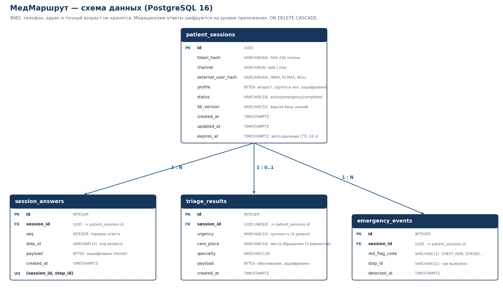
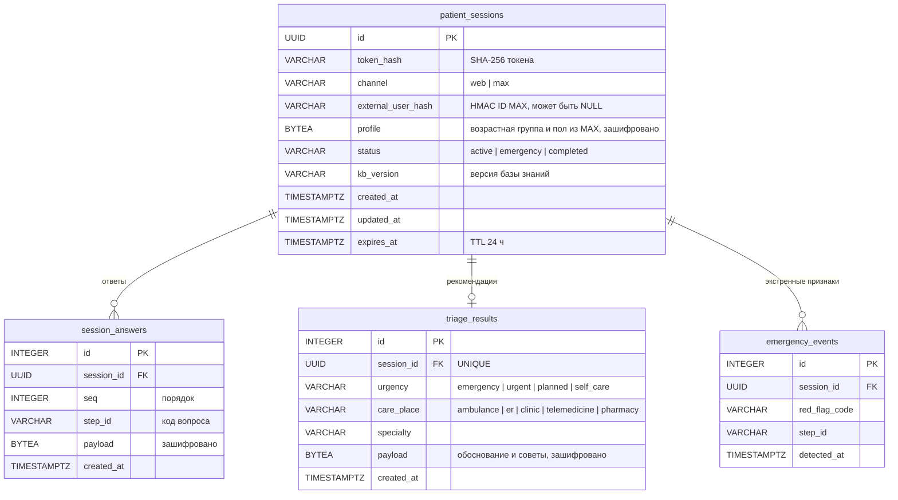

# Схема данных МедМаршрут

## Таблицы

**patient_sessions** — анонимная сессия опроса. Личность пациента не устанавливается.
`token_hash` — хеш секрета, который знает только клиент. `expires_at` — момент автоматического
удаления; продлевается при каждом ответе. `profile` — только возрастная группа и пол из
профиля MAX (зашифрованы); заполняется при входе из мини-приложения. `kb_version` фиксирует, по какой версии базы знаний
сформирована рекомендация (воспроизводимость и аудит).

**session_answers** — ответы в порядке получения (`seq`). Содержимое ответа (`payload`:
выбранные варианты, свободный текст, признак пропуска) зашифровано. Уникальность
`(session_id, step_id)` не даёт ответить на один вопрос дважды. Кнопка «Назад» удаляет
последний ответ.

**triage_results** — итоговая карточка (0 или 1 на сессию). Срочность, место и специальность
лежат открыто, чтобы строить обезличенную статистику; текст обоснования зашифрован.
CHECK-ограничения не пропускают недопустимые значения.

**emergency_events** — журнал выявленных экстренных признаков: какой признак и на каком шаге.
Нужен для аудита безопасности и разбора спорных случаев.

## Что сознательно НЕ хранится

ФИО, телефон, e-mail, адрес, номер полиса и паспорта, точная дата рождения, геолокация,
исходный ID пользователя мессенджера, названия принимаемых лекарств. Из ответа core MAX
(СНИЛС, полис ОМС, ФИО, телефон, дата рождения) сохраняются только возрастная группа и пол.

## Справочники

Вопросы, варианты ответов, категории, экстренные признаки и правила маршрутизации хранятся
в коде (`backend/app/domain/knowledge.py`, `triage.py`), а не в БД: так они версионируются
в git, проходят ревью и покрываются тестами. При необходимости их можно вынести в таблицы
без изменения API.
